<picture><source media="(prefers-color-scheme: dark)" srcset="./assets/vince-mono-dark.svg" />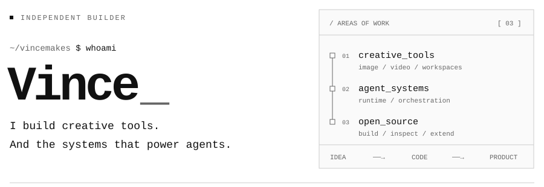</picture>

<a href="https://www.hivince.com"><picture><source media="(prefers-color-scheme: dark)" srcset="./assets/profile/blog-dark.svg" /></picture></a> &nbsp; <a href="https://x.com/hi__vince"><picture><source media="(prefers-color-scheme: dark)" srcset="./assets/profile/social-dark.svg" />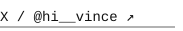</picture></a>

I build **AI-powered tools for creating and getting things done** — from images and films to agent-powered workspaces. I also open-source the systems behind better agent workflows, and write about what I learn along the way.

<picture><source media="(prefers-color-scheme: dark)" srcset="./assets/profile/products-dark.svg" />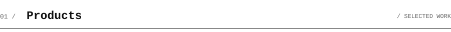</picture>

<a href="https://flowpix.ai"><picture><source media="(prefers-color-scheme: dark)" srcset="./assets/profile/flowpix-dark.svg" />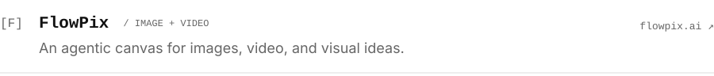</picture></a> 
<a href="https://uooki.com"><picture><source media="(prefers-color-scheme: dark)" srcset="./assets/profile/uooki-dark.svg" />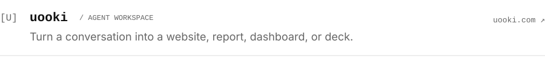</picture></a> 
<a href="https://reelfo.com"><picture><source media="(prefers-color-scheme: dark)" srcset="./assets/profile/reelfo-dark.svg" /></picture></a> 

<picture><source media="(prefers-color-scheme: dark)" srcset="./assets/profile/open-source-dark.svg" />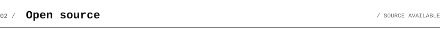</picture>

<a href="https://github.com/vincemakes/kiso"><picture><source media="(prefers-color-scheme: dark)" srcset="./assets/profile/kiso-dark.svg" />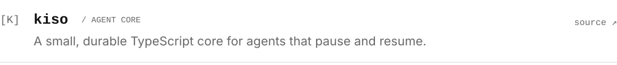</picture></a> 
<a href="https://github.com/vincemakes/model-boss"><picture><source media="(prefers-color-scheme: dark)" srcset="./assets/profile/model-boss-dark.svg" />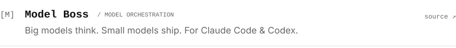</picture></a> 

<picture><source media="(prefers-color-scheme: dark)" srcset="./assets/profile/notes-dark.svg" />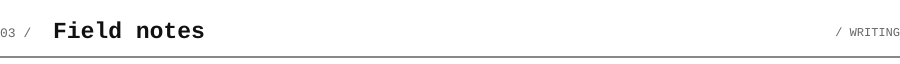</picture>

<a href="https://www.hivince.com/en/blog/the-agent-microkernel-notes-from-thinking-and-building"><picture><source media="(prefers-color-scheme: dark)" srcset="./assets/profile/microkernel-dark.svg" />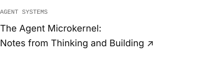</picture></a>
<a href="https://www.hivince.com/en/blog/harness-engineering"><picture><source media="(prefers-color-scheme: dark)" srcset="./assets/profile/harness-dark.svg" />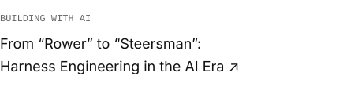</picture></a>

<a href="https://www.hivince.com"><picture><source media="(prefers-color-scheme: dark)" srcset="./assets/profile/more-notes-dark.svg" /></picture></a>

<a href="https://kiso.work"><picture><source media="(prefers-color-scheme: dark)" srcset="./assets/profile/footer-dark.svg" />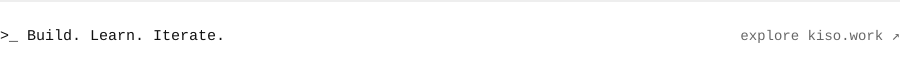</picture></a>
